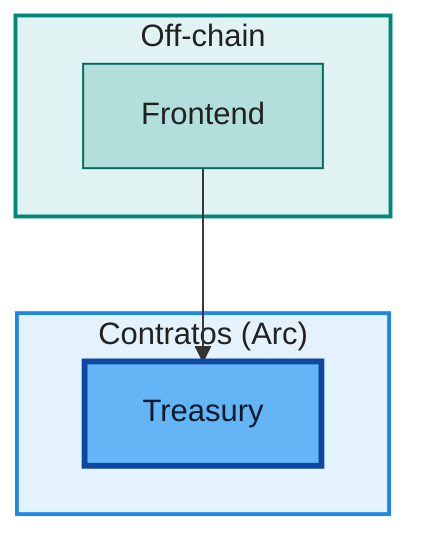

# Mermaid Diagrams Rule

Todo diagrama Mermaid criado ou editado neste repositório deve ser **colorido
de forma semântica e consistente**, seguindo a paleta e as técnicas abaixo.
Diagramas monocromáticos ou com cores aleatórias devem ser corrigidos.

## Paleta padrão (papel do elemento → cor)

| Papel | classDef | Fill | Stroke | Uso típico |
|---|---|---|---|---|
| Ator / pessoa | `actor` | `#FFE0B2` | `#E65100` | Membros, doadores, signatários, usuários |
| Serviço off-chain | `offchain` | `#B2DFDB` | `#00695C` | Frontend, backend, comprovação, on-ramp, smart accounts |
| Governança | `gov` | `#FFCCBC` | `#BF360C` | Multisig, timelock, pausa, propostas |
| Contrato on-chain | `contract` | `#BBDEFB` | `#1565C0` | Módulos Solidity em geral |
| Tesouraria | `treasury` | `#64B5F6` | `#0D47A1` (3px) | Treasury e cofres centrais |
| Token / moeda do projeto | `token` | `#FFF59D` | `#F9A825` (2px) | Faísca e instrumentos próprios |
| Adapter | `adapter` | `#E1BEE7` | `#6A1B9A` | IInvestmentAdapter, IProductAdapter |
| Externo | `external` | `#CFD8DC` | `#455A64` | USDC, BRLA, protocolos DeFi/RWA, site, legado Web2 |

Texto sempre escuro: `color:#212121` (ou `#0D1B2A` em fills saturados).

Subgraphs usam a mesma família de cores com fill mais claro e stroke médio:

| Contexto do subgraph | Fill | Stroke |
|---|---|---|
| Atores | `#FFF8E1` | `#F9A825` |
| Off-chain | `#E0F2F1` | `#00897B` |
| Governança | `#FBE9E7` | `#E64A19` |
| Contratos on-chain (rede/Arc) | `#E3F2FD` | `#1E88E5` |
| Adapters | `#F3E5F5` | `#8E24AA` |
| Externos | `#ECEFF1` | `#607D8B` |

## Técnica por tipo de diagrama

### flowchart / graph

Declare os `classDef` no **final do bloco**, atribua com `class` e pinte os
subgraphs com `style`:



### classDiagram

`classDef`/`class` funcionam; atribua classes por papel (contrato, interface,
adapter, token). Sintaxe restrita neste tipo: **um `class` por linha, sem
ponto e vírgula** — `class A contract` (válido), `class A,B contract;` e
`class A contract;` quebram o parser. Alternativa: `cssClass "A" contract`.
`style` de subgraph não se aplica a classDiagram.

### sequenceDiagram

`classDef` não se aplica. Use a diretiva `%%{init: ...}%%` na **primeira
linha do bloco** com as `themeVariables` da paleta:

```mermaid
%%{init: {'theme':'base','themeVariables':{'actorBkg':'#BBDEFB','actorBorder':'#1565C0','actorTextColor':'#212121','activationBkgColor':'#BBDEFB','activationBorderColor':'#1565C0','signalColor':'#37474F','signalTextColor':'#212121','labelBoxBkgColor':'#FFE0B2','labelBoxBorderColor':'#E65100','noteBkgColor':'#FFF59D','noteBorderColor':'#F9A825','noteTextColor':'#212121','sequenceNumberColor':'#FFFFFF','actorLineColor':'#90A4AE','messageTextColor':'#212121'}}}%%
sequenceDiagram
    ...
```

### stateDiagram-v2

Prefira `classDef`/`class` quando suportado pela versão do renderer; se o
render falhar, use o mesmo bloco `%%{init}%%` de themeVariables. Sempre
valide o render antes de considerar a edição pronta.

## Regras de aplicação

- Cor tem **significado**: não varie a paleta por preferência estética;
  aplique-a pelo papel do elemento no sistema.
- Elementos do mesmo papel recebem a mesma classe em todos os documentos.
- Não deixe texto claro sobre fundo claro nem fundo escuro sem ajuste de cor.
- Blocos ` ```text ` (diagramas ASCII) só se mantêm quando a intenção é um
  resumo compacto; diagrama de arquitetura deve ser Mermaid colorido.
- Ao criar um documento novo, copie o `classDef` canônico acima — não
  reinvente nomes de classes.
- Valide sempre com o pipeline de PDF (`scripts/docs/md-to-pdf.sh`) ou um render
  isolado via `mmdc`; um `classDef` com nome errado ou `style` em subgraph
  inexistente quebra o render.
